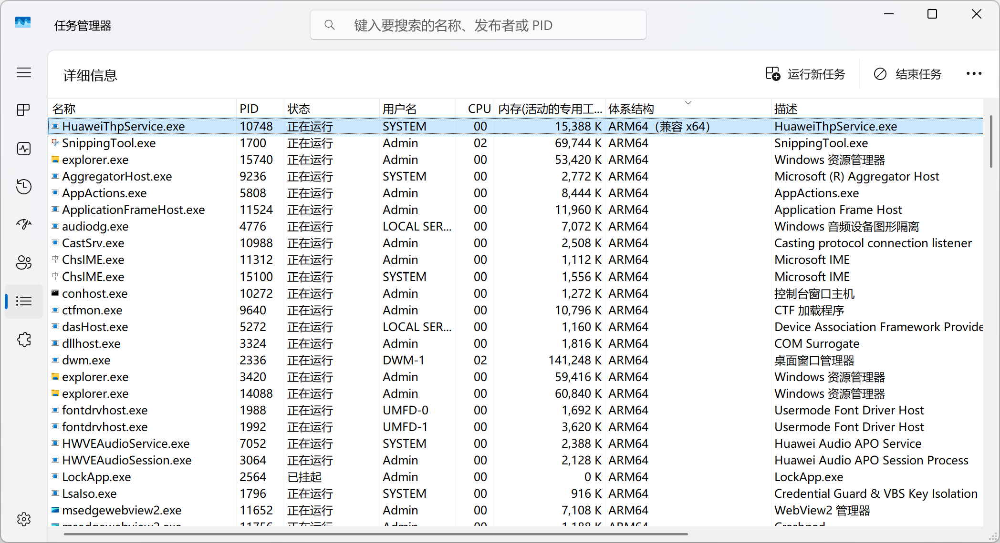

<h1 align="center">HuaweiThpService</h1>

> [!WARNING]
> **本项目已过时，不再推荐使用。**
>
> 建议改用 [EGoTouchRev](https://github.com/awarson2233/EGoTouchRev)。该项目提供纯原生 Arm64 适配，并带来更好的性能表现。

## 📋 项目简介

本项目将华为 MateBook E Go 系列触摸服务适配为 Arm64EC 架构。

## 🚀 快速开始

### 安装步骤

1. **下载最新版本**
   - 从 [Release](../../releases) 页面下载最新版本的 `HuaweiThpService.exe`

2. **停止现有服务**
   - 按 <kbd>Win</kbd> + <kbd>R</kbd> 打开运行对话框
   - 输入 `services.msc` 打开服务管理器
   - 找到 `HuaweiThpService` 服务并停止

3. **替换可执行文件**
   - 将下载的 `HuaweiThpService.exe` 替换以下路径的文件：

   ```
   C:\Program Files\Huawei\HuaweiThpService\HuaweiThpService.exe
   ```

4. **验证安装**
   - 在服务管理器中启动 `HuaweiThpService` 服务

### 效果预览



## 📧 反馈与贡献

欢迎提交 Issue 和 Pull Request！
